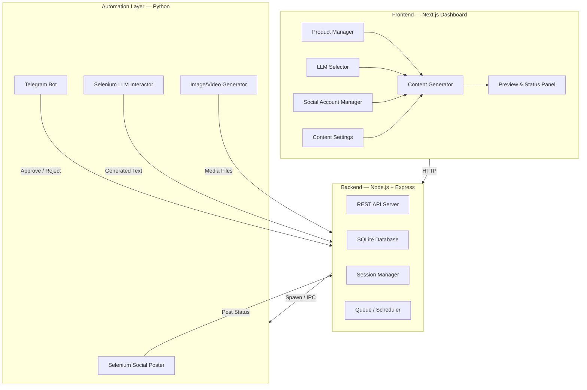
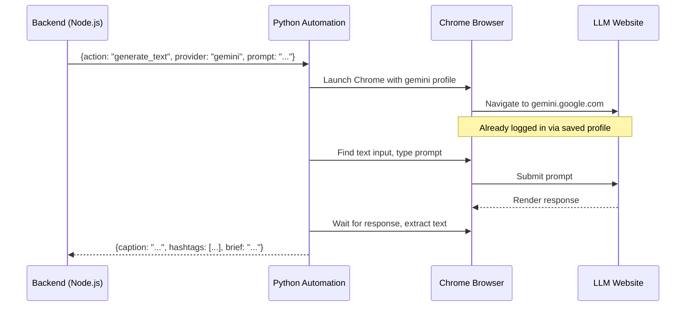
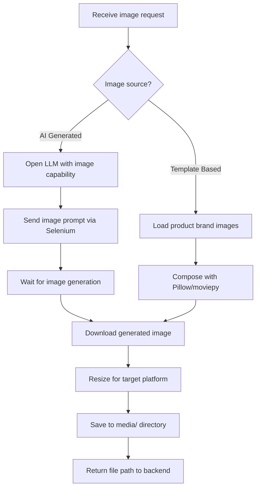
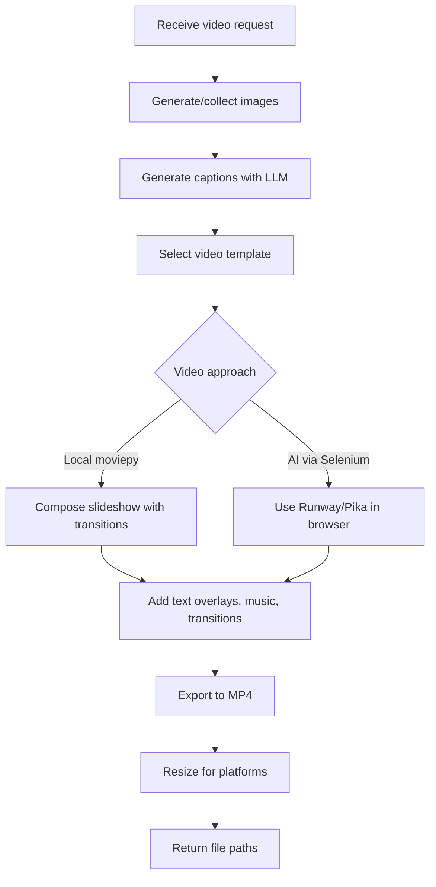
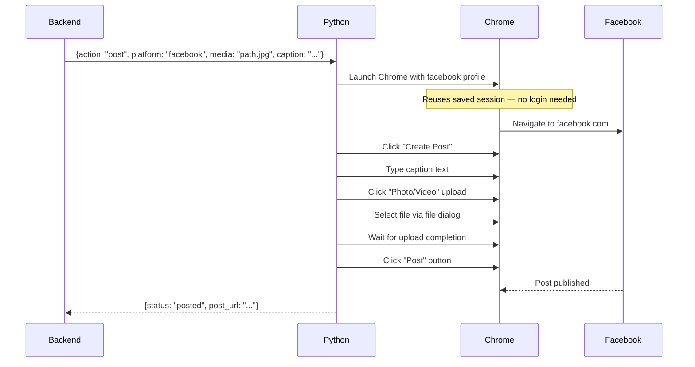
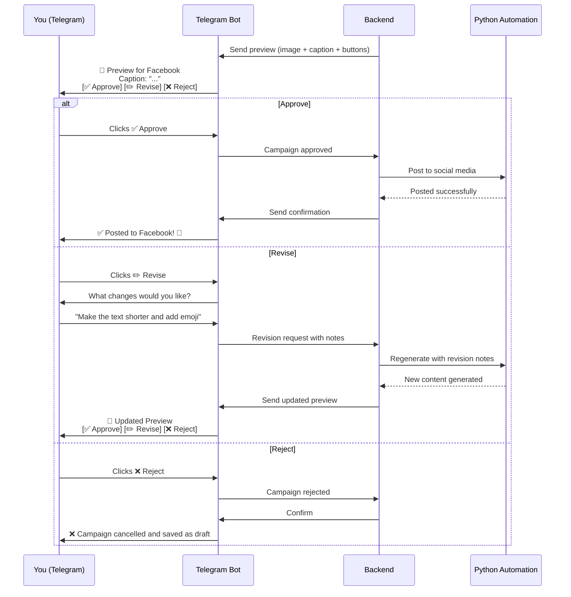
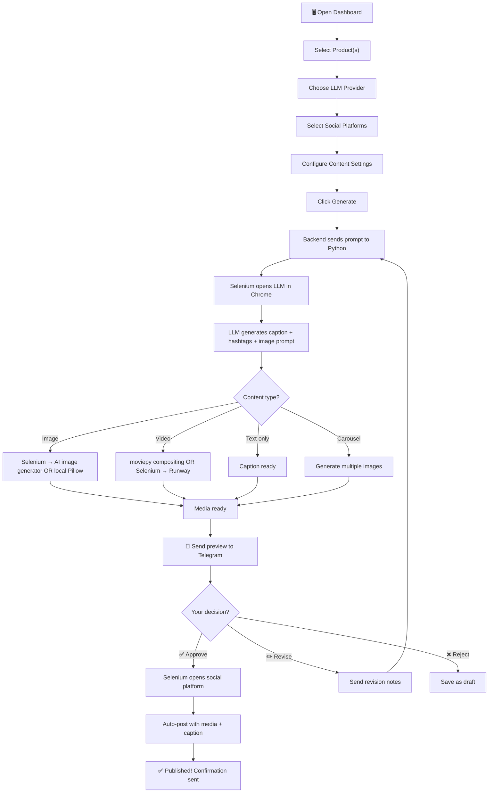

# AI-Powered Social Media Automation — Full Project Plan

> **Zero API keys for social platforms.** Every social action uses Selenium browser automation with saved Chrome profiles. LLM interaction also happens via Selenium on already-logged-in browser tabs.

---

## 1. High-Level Architecture



---

## 2. Technology Stack

| Layer | Technology | Why |
|---|---|---|
| **Frontend** | Next.js 14 (App Router) | SSR, file-based routing, great DX |
| **Styling** | Vanilla CSS + CSS Variables | Full control, premium design system |
| **Backend API** | Node.js + Express | Simple REST, easy IPC with Python |
| **Database** | SQLite via `better-sqlite3` | Zero setup, file-based, perfect for local tool |
| **Automation** | Python 3.11 + Selenium 4 | Best Selenium ecosystem, undetected-chromedriver |
| **Browser Driver** | `undetected-chromedriver` | Bypasses bot detection on social platforms |
| **Image Generation** | Selenium → DALL-E / Gemini Image / Ideogram (in-browser) | No API keys needed |
| **Video Generation** | `moviepy` + templates OR Selenium → Runway/Pika (in-browser) | Local compositing or browser-based AI |
| **Telegram Bot** | `python-telegram-bot` | Only component that uses an API (Telegram Bot API — free) |
| **IPC** | Child process spawn + JSON over stdin/stdout | Simple, no extra infra |
| **Encryption** | `crypto` (Node.js) / `cryptography` (Python) | AES-256 for stored credentials |

---

## 3. Frontend Plan

### 3.1 Page Structure

```
/                         → Dashboard home (overview + quick actions)
/products                 → Product management (CRUD)
/products/[id]            → Edit single product
/accounts                 → Social media account management
/generate                 → Content generation wizard
/generate/preview         → Preview before sending to Telegram
/campaigns                → Campaign history & status tracking
/settings                 → LLM provider config, Telegram bot setup
```

### 3.2 Dashboard Home (`/`)

| Section | Content |
|---|---|
| **Quick Stats** | Total products, connected accounts, posts this week, pending approvals |
| **Recent Activity** | Timeline of last 10 actions (generated, approved, posted, rejected) |
| **Quick Generate** | One-click "Generate for [Product]" buttons |
| **Pending Approvals** | Cards showing content waiting for Telegram approval |

### 3.3 Product Manager (`/products`)

```
┌─────────────────────────────────────────────────┐
│  Products                          [+ Add New]  │
├─────────────────────────────────────────────────┤
│  ┌──────────┐  ┌──────────┐  ┌──────────┐      │
│  │ Product  │  │ Product  │  │ Product  │      │
│  │  Card 1  │  │  Card 2  │  │  Card 3  │      │
│  │  Logo    │  │  Logo    │  │  Logo    │      │
│  │  Name    │  │  Name    │  │  Name    │      │
│  │  Edit    │  │  Edit    │  │  Edit    │      │
│  └──────────┘  └──────────┘  └──────────┘      │
└─────────────────────────────────────────────────┘
```

**Fields per product:**

| Field | Type | Required |
|---|---|---|
| Product Name | Text | ✅ |
| Description | Textarea | ✅ |
| Category | Dropdown (Service/Software/Physical/Other) | ✅ |
| Website URL | URL | ❌ |
| Logo | File upload | ❌ |
| Brand Images | Multi-file upload | ❌ |
| Target Audience | Textarea | ✅ |
| Key Benefits | Tag input (multiple) | ✅ |
| Brand Colors | Color picker (primary, secondary, accent) | ❌ |
| Tone of Voice | Dropdown (Professional/Casual/Friendly/Bold/Inspirational) | ✅ |
| Disclaimer Text | Textarea | ❌ |
| Custom Prompt Template | Textarea | ❌ |
| Campaign Objectives | Multi-select (Awareness/Leads/Sales/Engagement) | ❌ |

### 3.4 Social Account Manager (`/accounts`)

**Dynamic credential fields based on platform selection:**

```
┌───────────────────────────────────────────────────┐
│  Connected Accounts                               │
├───────────────────────────────────────────────────┤
│                                                   │
│  ☑ Facebook    ☑ Instagram   ☐ LinkedIn   ☐ WhatsApp │
│                                                   │
│  ┌─ Facebook ─────────────────────────────────┐   │
│  │  Email/Phone: [__________________________] │   │
│  │  Password:    [__________________________] │   │
│  │  Page Name:   [__________________________] │   │
│  │  Status: 🟢 Verified     [Test Login]      │   │
│  └────────────────────────────────────────────┘   │
│                                                   │
│  ┌─ Instagram ────────────────────────────────┐   │
│  │  Username:    [__________________________] │   │
│  │  Password:    [__________________________] │   │
│  │  Account Type: ○ Personal  ● Professional  │   │
│  │  Status: 🟡 Not Verified  [Test Login]     │   │
│  └────────────────────────────────────────────┘   │
│                                                   │
│  [Save All Credentials]                           │
└───────────────────────────────────────────────────┘
```

**Per-platform fields:**

| Platform | Fields |
|---|---|
| **Facebook** | Email/Phone, Password, Page Name (optional) |
| **Instagram** | Username, Password, Account Type (Personal/Professional) |
| **LinkedIn** | Email, Password, Profile/Org toggle, Org Name (if org) |
| **WhatsApp** | Phone Number, QR code scan flow (Selenium shows QR) |

> [!IMPORTANT]
> **First-time login flow:** When user clicks "Test Login", Selenium opens a real Chrome window. User completes MFA manually once. The Chrome profile is saved to disk. All subsequent logins reuse this profile — no MFA needed again.

### 3.5 Content Generation Wizard (`/generate`)

**Multi-step wizard:**

```
Step 1: Select Product(s)          ──────────────────────►
Step 2: Choose LLM Provider        ──────────────────────►
Step 3: Select Target Platforms     ──────────────────────►
Step 4: Content Settings            ──────────────────────►
Step 5: Review & Generate           ──────────────────────►
```

**Step 4 — Content Settings Panel:**

| Setting | Options |
|---|---|
| Content Type | Text Post · Image · Video · Carousel |
| Language | English · Hindi · Both (bilingual) |
| Audience | From product defaults or custom override |
| Tone | From product defaults or custom override |
| Call to Action | Learn More · Sign Up · Buy Now · Contact Us · Custom |
| Hashtag Strategy | Auto-generate · Manual · Mix |
| Aspect Ratio (image/video) | 1:1 · 4:5 · 9:16 · 16:9 |
| Video Duration | 15s · 30s · 60s |
| Visual Style | Minimal · Bold · Gradient · Photo-realistic · Illustrated |
| Custom Instructions | Free-text prompt additions |

### 3.6 Campaign History (`/campaigns`)

| Column | Description |
|---|---|
| Date | When generated |
| Product | Which product |
| Platforms | Target social accounts |
| Content Type | Text/Image/Video/Carousel |
| Status | Draft · Pending Approval · Approved · Posted · Rejected |
| Actions | View · Re-generate · Delete |

### 3.7 Design System

```css
/* Color Palette */
--bg-primary:     hsl(230, 25%, 8%);      /* Deep navy black */
--bg-secondary:   hsl(230, 20%, 12%);     /* Card background */
--bg-tertiary:    hsl(230, 18%, 16%);     /* Elevated surfaces */
--accent-primary: hsl(250, 85%, 65%);     /* Electric violet */
--accent-secondary: hsl(190, 90%, 55%);   /* Cyan */
--accent-gradient: linear-gradient(135deg, var(--accent-primary), var(--accent-secondary));
--text-primary:   hsl(0, 0%, 95%);
--text-secondary: hsl(230, 10%, 60%);
--success:        hsl(145, 70%, 50%);
--warning:        hsl(40, 95%, 55%);
--danger:         hsl(0, 75%, 55%);
--border:         hsl(230, 15%, 20%);

/* Typography — Inter from Google Fonts */
--font-family: 'Inter', system-ui, sans-serif;
--font-xs:  0.75rem;   /* 12px */
--font-sm:  0.875rem;  /* 14px */
--font-md:  1rem;      /* 16px */
--font-lg:  1.25rem;   /* 20px */
--font-xl:  1.5rem;    /* 24px */
--font-2xl: 2rem;      /* 32px */
--font-3xl: 2.5rem;    /* 40px */

/* Spacing scale */
--space-1: 0.25rem;
--space-2: 0.5rem;
--space-3: 0.75rem;
--space-4: 1rem;
--space-6: 1.5rem;
--space-8: 2rem;
--space-12: 3rem;

/* Effects */
--glass: background: rgba(255,255,255,0.05); backdrop-filter: blur(12px);
--shadow-sm: 0 1px 3px rgba(0,0,0,0.3);
--shadow-md: 0 4px 12px rgba(0,0,0,0.4);
--shadow-lg: 0 8px 32px rgba(0,0,0,0.5);
--radius-sm: 8px;
--radius-md: 12px;
--radius-lg: 16px;
--radius-xl: 24px;

/* Transitions */
--transition-fast: 150ms ease;
--transition-normal: 250ms ease;
--transition-slow: 400ms cubic-bezier(0.4, 0, 0.2, 1);
```

---

## 4. Backend Plan

### 4.1 API Endpoints

#### Products
```
GET    /api/products              → List all products
POST   /api/products              → Create product
GET    /api/products/:id          → Get single product
PUT    /api/products/:id          → Update product
DELETE /api/products/:id          → Delete product
POST   /api/products/:id/logo     → Upload logo
POST   /api/products/:id/images   → Upload brand images
```

#### Social Accounts
```
GET    /api/accounts              → List all accounts
POST   /api/accounts              → Save credentials (encrypted)
PUT    /api/accounts/:id          → Update credentials
DELETE /api/accounts/:id          → Remove account
POST   /api/accounts/:id/test     → Trigger Selenium test login
GET    /api/accounts/:id/status   → Check login session status
```

#### Content Generation
```
POST   /api/generate/text         → Generate text content via LLM (Selenium)
POST   /api/generate/image        → Generate image (Selenium or local)
POST   /api/generate/video        → Generate video (local compositing)
POST   /api/generate/carousel     → Generate carousel set
GET    /api/generate/:id/status   → Check generation progress
```

#### Campaigns
```
GET    /api/campaigns             → List all campaigns
POST   /api/campaigns             → Create new campaign
GET    /api/campaigns/:id         → Get campaign details
PUT    /api/campaigns/:id         → Update campaign
POST   /api/campaigns/:id/approve → Approve and publish
POST   /api/campaigns/:id/reject  → Reject campaign
POST   /api/campaigns/:id/revise  → Send revision instructions
```

#### Telegram
```
POST   /api/telegram/setup        → Configure bot token + chat ID
GET    /api/telegram/status       → Check bot connection
POST   /api/telegram/send-preview → Manually trigger preview send
```

#### Settings
```
GET    /api/settings              → Get all settings
PUT    /api/settings              → Update settings
GET    /api/settings/llm          → Get LLM provider config
PUT    /api/settings/llm          → Update LLM provider
```

### 4.2 Database Schema (SQLite)

```sql
-- Products
CREATE TABLE products (
    id          INTEGER PRIMARY KEY AUTOINCREMENT,
    name        TEXT NOT NULL,
    description TEXT,
    category    TEXT,
    website_url TEXT,
    logo_path   TEXT,
    target_audience TEXT,
    key_benefits    TEXT,  -- JSON array
    brand_colors    TEXT,  -- JSON {primary, secondary, accent}
    tone        TEXT,
    disclaimer  TEXT,
    custom_prompt   TEXT,
    campaign_objectives TEXT,  -- JSON array
    created_at  DATETIME DEFAULT CURRENT_TIMESTAMP,
    updated_at  DATETIME DEFAULT CURRENT_TIMESTAMP
);

-- Brand Images
CREATE TABLE product_images (
    id          INTEGER PRIMARY KEY AUTOINCREMENT,
    product_id  INTEGER REFERENCES products(id) ON DELETE CASCADE,
    file_path   TEXT NOT NULL,
    file_name   TEXT,
    created_at  DATETIME DEFAULT CURRENT_TIMESTAMP
);

-- Social Accounts
CREATE TABLE social_accounts (
    id              INTEGER PRIMARY KEY AUTOINCREMENT,
    platform        TEXT NOT NULL,  -- facebook | instagram | linkedin | whatsapp
    username        TEXT,
    encrypted_password TEXT,
    extra_fields    TEXT,  -- JSON for platform-specific fields
    chrome_profile_path TEXT,
    session_status  TEXT DEFAULT 'unverified',  -- unverified | verified | expired
    last_verified   DATETIME,
    created_at      DATETIME DEFAULT CURRENT_TIMESTAMP,
    updated_at      DATETIME DEFAULT CURRENT_TIMESTAMP
);

-- Campaigns
CREATE TABLE campaigns (
    id              INTEGER PRIMARY KEY AUTOINCREMENT,
    product_id      INTEGER REFERENCES products(id),
    llm_provider    TEXT,  -- gemini | chatgpt | claude
    content_type    TEXT,  -- text | image | video | carousel
    language        TEXT,
    platforms       TEXT,  -- JSON array of platform names
    audience        TEXT,
    tone            TEXT,
    cta             TEXT,
    hashtags        TEXT,
    aspect_ratio    TEXT,
    video_duration  INTEGER,
    visual_style    TEXT,
    custom_instructions TEXT,
    generated_caption   TEXT,
    generated_hashtags  TEXT,
    media_paths     TEXT,  -- JSON array of file paths
    status          TEXT DEFAULT 'draft',
    -- draft | generating | preview_sent | approved | posting | posted | rejected | revision
    telegram_message_id TEXT,
    revision_notes  TEXT,
    revision_count  INTEGER DEFAULT 0,
    posted_at       DATETIME,
    created_at      DATETIME DEFAULT CURRENT_TIMESTAMP,
    updated_at      DATETIME DEFAULT CURRENT_TIMESTAMP
);

-- Settings
CREATE TABLE settings (
    key   TEXT PRIMARY KEY,
    value TEXT
);
-- Pre-populated keys:
-- llm_provider, telegram_bot_token, telegram_chat_id,
-- encryption_key, default_language, default_tone
```

### 4.3 Credential Security

```
┌─────────────────────────────────────────────┐
│          Credential Storage Flow            │
├─────────────────────────────────────────────┤
│                                             │
│  User enters password in dashboard          │
│           │                                 │
│           ▼                                 │
│  AES-256-GCM encrypt with master key        │
│  Master key = derived from machine-specific │
│  secret + user-set passphrase               │
│           │                                 │
│           ▼                                 │
│  Store encrypted blob in SQLite             │
│           │                                 │
│           ▼                                 │
│  On Selenium login: decrypt in memory       │
│  → type into browser → clear from memory    │
│                                             │
└─────────────────────────────────────────────┘
```

> [!CAUTION]
> Credentials are stored locally with AES-256 encryption. The master passphrase is set once during first launch. **Never** commit the SQLite database or Chrome profiles to version control.

---

## 5. Automation Layer (Python)

### 5.1 Selenium Chrome Profile Strategy

```
chrome_profiles/
├── facebook/
│   └── Default/          ← Full Chrome profile with cookies & session
├── instagram/
│   └── Default/
├── linkedin/
│   └── Default/
├── whatsapp/
│   └── Default/
├── gemini/
│   └── Default/
├── chatgpt/
│   └── Default/
└── claude/
    └── Default/
```

**How it works:**
1. First login: Selenium opens Chrome with a **dedicated profile directory** per platform
2. User logs in manually, completes MFA
3. Chrome saves cookies/session to the profile directory
4. All future launches reuse the same profile → **no MFA, no re-login**

### 5.2 Python Module Structure

```
automation/
├── __init__.py
├── main.py                  ← Entry point, receives commands via stdin JSON
├── config.py                ← Paths, constants
├── browser/
│   ├── __init__.py
│   ├── driver.py            ← Chrome driver setup with undetected-chromedriver
│   ├── profiles.py          ← Profile management
│   └── utils.py             ← Wait helpers, screenshot, error handling
├── llm/
│   ├── __init__.py
│   ├── base.py              ← Abstract LLM interactor
│   ├── gemini.py            ← Navigate to gemini.google.com, type prompt, extract response
│   ├── chatgpt.py           ← Navigate to chatgpt.com, type prompt, extract response
│   └── claude.py            ← Navigate to claude.ai, type prompt, extract response
├── social/
│   ├── __init__.py
│   ├── base.py              ← Abstract social poster
│   ├── facebook.py          ← Login, create post, upload media
│   ├── instagram.py         ← Login, create post/reel/story
│   ├── linkedin.py          ← Login, create post, upload media
│   └── whatsapp.py          ← Login via QR, send to status/group
├── media/
│   ├── __init__.py
│   ├── image_generator.py   ← Selenium → AI image tools (Gemini Image, DALL-E in ChatGPT)
│   ├── video_generator.py   ← moviepy-based video compositing from images + text
│   └── templates/           ← Video/image templates
├── telegram/
│   ├── __init__.py
│   └── bot.py               ← Telegram bot: send previews, handle approve/reject/revise
└── utils/
    ├── __init__.py
    ├── encryption.py         ← AES-256 encrypt/decrypt
    └── logger.py             ← Structured logging
```

### 5.3 LLM Interaction Flow (Selenium)



**Prompt template example:**
```
You are a social media marketing expert. Create a {content_type} post for {platform}.

Product: {product_name}
Description: {product_description}
Target Audience: {target_audience}
Key Benefits: {key_benefits}
Tone: {tone}
Language: {language}
Call to Action: {cta}

Requirements:
1. Write an engaging caption (max {char_limit} characters)
2. Generate {hashtag_count} relevant hashtags
3. Include a clear call to action
4. {platform_specific_instructions}

Output format (JSON):
{
  "caption": "...",
  "hashtags": ["#tag1", "#tag2"],
  "cta_text": "...",
  "image_prompt": "describe the ideal image for this post",
  "alt_text": "accessibility description"
}
```

### 5.4 Image Generation Flow



**Platform-specific image sizes:**

| Platform | Post | Story/Reel | Carousel |
|---|---|---|---|
| Facebook | 1200×630 | 1080×1920 | 1080×1080 |
| Instagram | 1080×1080 | 1080×1920 | 1080×1080 |
| LinkedIn | 1200×627 | N/A | 1080×1080 |
| WhatsApp | 800×800 | 1080×1920 | N/A |

### 5.5 Video Generation Flow



### 5.6 Social Media Posting Flow (Selenium)



### 5.7 Telegram Bot Flow



---

## 6. Complete Workflow



---

## 7. Folder Structure

```
ai-social-media/
├── package.json                 ← Node.js project root
├── next.config.js
├── .env.local                   ← Telegram bot token, master key salt
├── .gitignore
│
├── public/
│   └── uploads/                 ← Product logos and brand images
│
├── src/
│   ├── app/                     ← Next.js App Router pages
│   │   ├── layout.js
│   │   ├── page.js              ← Dashboard home
│   │   ├── products/
│   │   │   ├── page.js          ← Product list
│   │   │   └── [id]/
│   │   │       └── page.js      ← Edit product
│   │   ├── accounts/
│   │   │   └── page.js          ← Social account manager
│   │   ├── generate/
│   │   │   ├── page.js          ← Generation wizard
│   │   │   └── preview/
│   │   │       └── page.js      ← Preview panel
│   │   ├── campaigns/
│   │   │   └── page.js          ← Campaign history
│   │   └── settings/
│   │       └── page.js          ← Settings
│   │
│   ├── components/
│   │   ├── layout/
│   │   │   ├── Sidebar.js
│   │   │   ├── Header.js
│   │   │   └── Layout.js
│   │   ├── ui/
│   │   │   ├── Button.js
│   │   │   ├── Card.js
│   │   │   ├── Input.js
│   │   │   ├── Select.js
│   │   │   ├── Modal.js
│   │   │   ├── Badge.js
│   │   │   ├── Toggle.js
│   │   │   ├── ColorPicker.js
│   │   │   ├── TagInput.js
│   │   │   ├── FileUpload.js
│   │   │   └── Stepper.js
│   │   ├── products/
│   │   │   ├── ProductCard.js
│   │   │   └── ProductForm.js
│   │   ├── accounts/
│   │   │   ├── AccountCard.js
│   │   │   ├── FacebookFields.js
│   │   │   ├── InstagramFields.js
│   │   │   ├── LinkedInFields.js
│   │   │   └── WhatsAppFields.js
│   │   ├── generate/
│   │   │   ├── ProductSelector.js
│   │   │   ├── LLMSelector.js
│   │   │   ├── PlatformSelector.js
│   │   │   ├── ContentSettings.js
│   │   │   └── GenerationStatus.js
│   │   └── campaigns/
│   │       ├── CampaignCard.js
│   │       └── CampaignTimeline.js
│   │
│   ├── styles/
│   │   ├── globals.css          ← CSS variables, reset, base styles
│   │   ├── layout.css           ← Sidebar, header, grid
│   │   ├── components.css       ← Button, card, input styles
│   │   ├── products.css
│   │   ├── accounts.css
│   │   ├── generate.css
│   │   ├── campaigns.css
│   │   └── animations.css       ← Micro-animations, transitions
│   │
│   ├── lib/
│   │   ├── db.js                ← SQLite connection + queries
│   │   ├── encryption.js        ← AES-256 encrypt/decrypt
│   │   ├── automation.js        ← Spawn Python process, IPC
│   │   └── constants.js         ← Platform configs, defaults
│   │
│   └── api/                     ← Next.js API routes (Route Handlers)
│       ├── products/
│       │   └── route.js
│       ├── accounts/
│       │   └── route.js
│       ├── generate/
│       │   └── route.js
│       ├── campaigns/
│       │   └── route.js
│       ├── telegram/
│       │   └── route.js
│       └── settings/
│           └── route.js
│
├── automation/                  ← Python automation layer
│   ├── requirements.txt
│   ├── main.py
│   ├── config.py
│   ├── browser/
│   ├── llm/
│   ├── social/
│   ├── media/
│   ├── telegram/
│   └── utils/
│
├── chrome_profiles/             ← Saved Chrome sessions (gitignored)
│   ├── facebook/
│   ├── instagram/
│   ├── linkedin/
│   ├── whatsapp/
│   ├── gemini/
│   ├── chatgpt/
│   └── claude/
│
├── data/
│   ├── database.sqlite          ← SQLite database (gitignored)
│   └── media/                   ← Generated images and videos
│       ├── images/
│       └── videos/
│
└── logs/                        ← Application logs
```

---

## 8. Implementation Phases

### Phase 1 — Foundation (Week 1-2)
| Task | Priority |
|---|---|
| Set up Next.js project with design system | 🔴 Critical |
| Create SQLite database and models | 🔴 Critical |
| Build dashboard layout (Sidebar, Header) | 🔴 Critical |
| Product CRUD (frontend + API) | 🔴 Critical |
| Python automation skeleton with driver setup | 🔴 Critical |

### Phase 2 — Account Management (Week 2-3)
| Task | Priority |
|---|---|
| Social account credential UI (dynamic fields) | 🔴 Critical |
| AES-256 encryption for credentials | 🔴 Critical |
| Selenium Chrome profile management | 🔴 Critical |
| Test login flow (open Chrome, manual MFA, save profile) | 🔴 Critical |
| Session status checking | 🟡 Medium |

### Phase 3 — LLM Integration (Week 3-4)
| Task | Priority |
|---|---|
| Selenium Gemini interactor | 🔴 Critical |
| Selenium ChatGPT interactor | 🔴 Critical |
| Selenium Claude interactor | 🔴 Critical |
| Prompt template system | 🔴 Critical |
| Node.js ↔ Python IPC layer | 🔴 Critical |

### Phase 4 — Content Generation (Week 4-5)
| Task | Priority |
|---|---|
| Image generation via Selenium (Gemini/DALL-E) | 🔴 Critical |
| Local image compositing with Pillow | 🟡 Medium |
| Video generation with moviepy | 🟡 Medium |
| Content generation wizard UI | 🔴 Critical |
| Platform-specific resizing | 🟡 Medium |

### Phase 5 — Telegram Bot (Week 5-6)
| Task | Priority |
|---|---|
| Telegram bot setup and configuration UI | 🔴 Critical |
| Send preview with inline keyboard buttons | 🔴 Critical |
| Approve → trigger post flow | 🔴 Critical |
| Revise → collect feedback → regenerate | 🔴 Critical |
| Reject → save as draft | 🟡 Medium |

### Phase 6 — Social Posting (Week 6-7)
| Task | Priority |
|---|---|
| Facebook Selenium poster | 🔴 Critical |
| Instagram Selenium poster | 🔴 Critical |
| LinkedIn Selenium poster | 🟡 Medium |
| WhatsApp status poster | 🟡 Medium |
| Post confirmation and status tracking | 🔴 Critical |

### Phase 7 — Polish (Week 7-8)
| Task | Priority |
|---|---|
| Campaign history and tracking UI | 🟡 Medium |
| Error handling and retry logic | 🔴 Critical |
| Dashboard stats and activity feed | 🟢 Nice-to-have |
| Multi-product batch generation | 🟢 Nice-to-have |
| Scheduling (post at specific time) | 🟢 Nice-to-have |

---

## 9. Prerequisites & Setup

### Required Software
```bash
# Node.js 18+ (for Next.js)
node --version

# Python 3.11+ (for automation)
python --version

# Chrome browser (latest stable)
google-chrome --version

# pip packages
pip install undetected-chromedriver selenium python-telegram-bot moviepy Pillow cryptography

# npm packages
npm install next react react-dom better-sqlite3 uuid
```

### Environment Variables (`.env.local`)
```env
# Master encryption passphrase (set once, never change)
MASTER_PASSPHRASE=your-secure-passphrase-here

# Telegram Bot
TELEGRAM_BOT_TOKEN=your-bot-token-from-botfather
TELEGRAM_CHAT_ID=your-telegram-chat-id

# Paths
CHROME_PROFILES_DIR=./chrome_profiles
MEDIA_OUTPUT_DIR=./data/media
DATABASE_PATH=./data/database.sqlite

# Python automation
PYTHON_PATH=python
AUTOMATION_DIR=./automation
```

### Telegram Bot Setup
1. Open Telegram, search `@BotFather`
2. Send `/newbot`, follow prompts
3. Copy the bot token to `.env.local`
4. Send any message to your bot
5. Visit `https://api.telegram.org/bot<TOKEN>/getUpdates` to get your `chat_id`

---

## 10. Key Design Decisions

| Decision | Rationale |
|---|---|
| **Selenium over APIs** | No API keys, no rate limits, no approval process. Works with any account. |
| **`undetected-chromedriver`** | Standard Selenium is detected and blocked by most platforms. |
| **Saved Chrome profiles** | Eliminates repeated MFA. Sessions persist across restarts. |
| **SQLite over PostgreSQL** | Local tool, single user, zero setup needed. |
| **Python for automation** | Best Selenium ecosystem, moviepy for video, Pillow for images. |
| **Node.js for backend** | Matches Next.js, good for IPC with child processes. |
| **Telegram for approvals** | Mobile-friendly, instant notifications, no need to keep dashboard open. |
| **AES-256 encryption** | Credentials at rest are encrypted. Decrypted only in memory during use. |

> [!WARNING]
> **Selenium automation on social platforms violates their Terms of Service.** This tool is designed for personal/small business use. Use responsibly. Avoid aggressive posting patterns that could trigger account bans.

---

## 11. Risk Mitigation

| Risk | Mitigation |
|---|---|
| Social platform detects bot | Use `undetected-chromedriver`, human-like delays, randomized timing |
| MFA re-triggered | Chrome profiles persist sessions; add backup OTP handling |
| LLM website UI changes | Abstract selectors into config files; easy to update |
| Chrome profile corruption | Auto-backup profiles periodically |
| Network failures | Retry logic with exponential backoff |
| Generated content is poor | Telegram approval loop prevents bad content from posting |

---

> [!TIP]
> **Ready to start building?** I recommend beginning with **Phase 1** — setting up the Next.js project with the design system, database, and product management. This gives you a working dashboard immediately while the automation layer develops in parallel.
